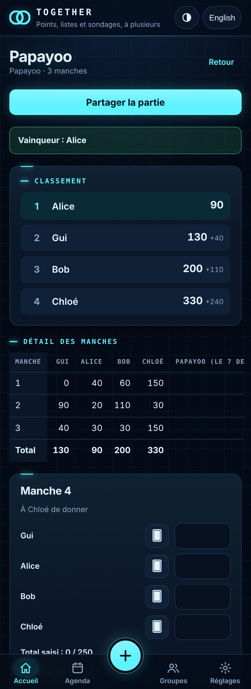
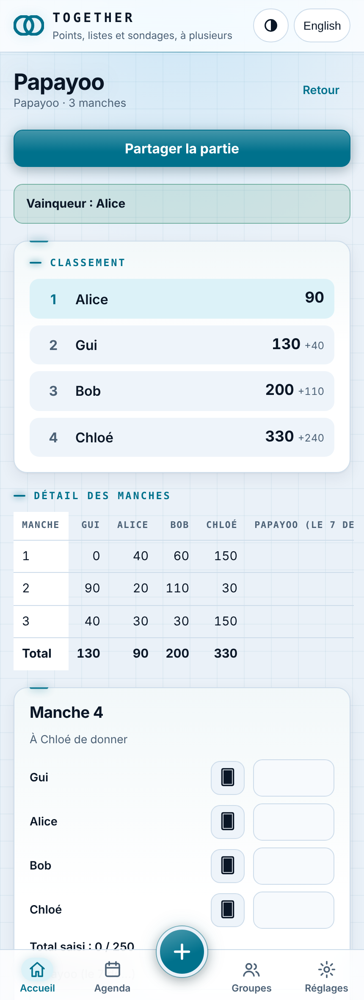

# 🃏 Together

Quatre onglets et un « + », une seule app. **Accueil** : en tête, une vue
d'ensemble en 3D (chaque groupe une étoile, ses éléments en orbite, ce qui
est rattaché à un événement autour de lui comme une lune ; sans les
personnes), puis les événements qui viennent, ce qui vous attend, ce qui est en cours — et, d'une rangée *Tout · Listes · Sondages
· Jeux · Comptes · Idées*, chaque sorte en entier : des **listes** à cocher
et à répartir, des **sondages** pour trancher une date ou un choix, un compteur
de points pour Papayoo et une vingtaine d'autres **parties**, des **comptes** de
dépenses (qui a payé quoi, qui rembourse qui), des tableaux d'**idées** (notes
et croquis au doigt). **Agenda** : les sondages qui
cherchent un jour, puis ce qui vient, jour par jour, avec pour chaque
événement sa liste et son compte. **Groupes** : vos groupes, leur page, entrer
et inviter. **Réglages** : votre prénom, l'apparence, vos données, la version. Une page
web, aucune dépendance, aucun build.

<p>
  
  
</p>

## Ce que ça fait — les parties

- **Une partie = des manches** : on saisit le score de chaque joueur, l'appli
  tient les totaux, le classement (ex æquo compris) et l'écart avec le leader.
- **Les règles de comptage du jeu sont connues** : sens du classement (le plus
  petit ou le plus grand total gagne), fin de partie (score limite, nombre de
  manches fixe, ou à la demande), total attendu par manche.
- **Contrôle de saisie** : à Papayoo une manche distribue exactement 250 points
  de pénalité — si le compte n'y est pas, l'appli le signale avant d'enregistrer.
  Le bouton *Compléter* remplit automatiquement le dernier score manquant.
- **Elle s'installe et marche hors ligne** : ajoutée à l'écran d'accueil, elle
  s'ouvre sans réseau — dans un train, une cave, un gîte — et se resynchronise
  au retour de la connexion.
- **Les résultats s'exportent** : un récapitulatif en texte à coller dans une
  conversation, ou un fichier **Word** et **PDF** du classement et des manches.
- **Statistiques par joueur** : parties jouées, gagnées, moyenne et meilleur
  score, jeu par jeu.
- **Rejouer** relance une partie avec les mêmes joueurs et les mêmes règles, et
  les noms déjà utilisés sont proposés à la saisie.
- **Le donneur tourne** : l'app rappelle à qui c'est de donner.
- **Passer l'app à quelqu'un, avec ou sans les parties** : *Partager l'app*, sur
  l'accueil, propose trois liens — l'app seule (la personne repart de zéro),
  l'app **avec toutes** vos parties, ou l'app avec **celles que vous cochez**.
  Le lien part par la feuille de partage du téléphone, ou s'affiche à copier avec
  un **code QR** ; il reste court quel que soit le nombre de parties, parce qu'il
  ne porte pas les parties mais un identifiant qui les désigne.
- **Le partage tient dans une idée : le groupe.** Un groupe — la famille, les
  copains du mardi — est un cercle de personnes. On y voit tout ce qui est
  partagé, parties, listes et sondages confondus, et on peut y partager à son
  tour ; qui n'en est pas ne peut rien y créer, même en récupérant la clé
  publique dans le code de la page. **Contribuer, en revanche, ne demande
  rien** : un lien envoyé à quelqu'un d'extérieur lui permet d'ajouter une
  manche ou de cocher une ligne, sans rien voir du reste.
- **On frappe à un groupe, et quelqu'un ouvre.** Vous envoyez un lien —
  d'une journée, pour plusieurs personnes ou pour une seule.
  En face, il n'y a qu'**un prénom à écrire** : rien ne s'ouvre, la demande
  arrive chez vous, et vous **acceptez ou refusez** d'une touche. Une invitation
  ne donne donc que le droit de frapper : transférée ou capturée, elle ne fait
  entrer personne sans vous. Accepté, l'appareil reçoit **une clé à lui**,
  étiquetée de ce prénom et coupable sans déranger les autres ; refusé, il n'a
  jamais rien vu. Le lien ne passe pas ? Le nom du groupe et les six chiffres,
  dits de vive voix, font exactement la même chose.
- **Chacun a son lien de retour.** Accepter quelqu'un fait entrer une *personne* :
  ses appareils ont chacun leur clé, mais tous lui appartiennent — et elle peut se
  faire un **lien à elle** qui rend une clé neuve à n'importe quel navigateur,
  sans que personne n'ait à l'accepter de nouveau. C'est la réponse aux deux vrais
  agacements : être entré depuis le navigateur d'une app de messagerie et vouloir
  la même chose dans Safari, et réinstaller l'app. Ce lien **naît sur son
  appareil** — celui qui fait entrer ne le voit jamais et ne peut donc pas se faire
  passer pour elle — et se **coupe** depuis *Qui est dans le groupe* sans mettre
  ses appareils dehors.
- **La porte reste entre vos mains.** Seule la clé affichée à la création du
  groupe accepte les demandes ; celles distribuées ensuite voient et partagent,
  mais n'ouvrent à personne. *Qui est dans le groupe* liste les appareils, un par
  ligne, et **Couper** met l'un d'eux dehors sans toucher aux autres — la
  dernière clé qui fait entrer étant protégée, un groupe ne peut pas se retrouver
  sans portier. Vingt essais ratés ferment l'entrée dix minutes ; cinquante
  demandes en attente et la porte n'en prend plus.
- **Elle se met à jour toute seule, et le dit.** L'app demande à chaque retour au
  premier plan s'il existe une version plus récente et se recharge une fois quand
  c'est le cas ; chaque fichier est revalidé plutôt que pris dans le cache du
  navigateur. La version est affichée dans Réglages, sous *Données*, avec un
  bouton pour chercher une mise à jour — parce qu'une app posée sur un écran
  d'accueil est reprise, jamais rechargée, et peut rester bloquée sans rien dire.
- **Ce qui est poussé ailleurs arrive ici tout seul** : en ouvrant l'app et
  chaque fois qu'on y revient, elle va chercher ce que le groupe a partagé
  depuis — Safari et l'app de l'écran d'accueil sont deux appareils, et ne se
  parlent que par la base. Le bouton **⟳** de la barre du haut le fait sur
  commande et dit combien d'éléments sont arrivés.
- **Et pendant qu'on regarde, aussitôt** : la base annonce chaque écriture sur
  Supabase Realtime (déclencheur `marque_points_live`) — une annonce vide, sur
  le canal du document et sur celui de son groupe, dont le nom est tiré au
  hasard et donné seulement avec une clé (`group_of` → `channel`). L'app
  écoute ses groupes, ses sondages « lien seulement » et le document à
  l'écran, puis redemande comme d'habitude, avec sa clé : une clé coupée
  n'apprend rien de plus. Sans Realtime (ou canal refusé, redemandé toutes les
  30 s), elle redemande toutes les 5 s (document ouvert) et 20 s (groupes),
  comme avant ; quand elle entend, une fois par minute seulement, au cas où
  une annonce se perdrait. Une connexion dont le serveur ne répond plus depuis
  une minute — un téléphone qui sort de veille en garde une qui se dit encore
  ouverte — n'est plus crue : l'app relève à nouveau elle-même et en rouvre une.
  `src/live.js` (client Phoenix écrit à la main) ; suite `direct`, contrôle
  SQL `annonces`.
- **Ce prénom sert ensuite partout** : le groupe voit qui est entré, et vous êtes
  proposé en premier dans une nouvelle liste, un sondage ou une partie — proposé
  une fois, au moment où le formulaire est vide ; effacé, il reste effacé. Il ne
  part de l'appareil que de deux façons : comme étiquette de sa clé, et comme
  n'importe quel prénom écrit dans une liste, qui suit cette liste quand elle
  est partagée.
- **Et pour faire entrer quelqu'un d'un coup, sans lui donner la clé** : un lien
  qui porte plusieurs documents, fermé par un **code à six chiffres** tiré au
  hasard — dix essais, puis il se bloque. Le lien et le code voyagent séparément,
  exprès : *Copier* ne copie que le lien. Ce que le lot désigne est chiffré avec
  ce code, donc la base elle-même ne le sait pas. *Mes partages*, dans l'onglet
  Réglages, rappelle chaque code et permet de **révoquer** un lien déjà envoyé.
- **Parties partagées, à la demande** : branchée sur une base (voir
  [docs/DEPLOIEMENT.md](docs/DEPLOIEMENT.md)), l'appli donne un lien par partie.
  La personne qui le reçoit ouvre la même partie, avec ses scores, et peut y
  ajouter des manches — chaque écran se rafraîchit tout seul. Rien ne quitte
  l'appareil tant que personne n'a appuyé sur *Partager*.
- **Le Tarot se calcule tout seul** : preneur, contrat, bouts et points réalisés,
  et l'appli en tire le score de chacun — en montrant son calcul, pour qu'il soit
  vérifiable à la table.
- **Compter les cartes au doigt** : pour les jeux dont le score est une pile de
  cartes, un compteur s'ouvre depuis la manche en cours. On touche les cartes
  ramassées, il fait la somme et reporte le score — plus d'addition de tête.
- **Correction** : on clique sur une ligne du tableau pour modifier ou supprimer
  une manche, *Annuler la dernière manche* défait la saisie précédente, et
  *Renommer* corrige un nom mal saisi sans toucher aux scores.
- **Ça marche sur téléphone**, hors ligne, en français ou en anglais (choisi
  dans **Réglages → Langue**, la langue du téléphone d'origine), avec une
  apparence au choix dans **Réglages → Apparence** : cinq styles (Hologramme,
  le style de l'app ; Classique, papier chaud et ambre ; Épuré, gris et plat ;
  Astronomie, un ciel de nuit — une carte du ciel en clair —, titres en
  capitales d'atlas ; Saisons, aux couleurs de la saison du calendrier), huit
  couleurs, du rouge au rose (celle du style est l'une d'elles, cochée
  d'origine), un fond qui bouge — celui du style, des étoiles (avec la lune
  telle qu'elle est ce soir et une étoile filante de temps en temps), une
  aurore, la saison (pétales, lucioles, feuilles, neige) ou des confettis,
  immobile si le téléphone demande moins d'animations —, nuit (par défaut) ou
  clair — aussi au bouton rond du haut. Gardé sur l'appareil, appliqué avant le
  premier affichage. La vue 3D de l'Accueil prend la nuit du style (chaude en
  Classique, violette en Astronomie…). Les parties sont enregistrées dans le
  navigateur, et exportables en JSON pour sauvegarder ou changer d'appareil.
- **Ce qui se voit d'un coup d'œil** : la flèche ‹ avant le titre ramène d'où
  l'on vient ; les cartes montrent les personnes par leurs initiales, dans une
  couleur tirée du prénom (la même partout) ; un onglet presque vide, ou un
  compte qui n'a qu'une dépense, porte un mot d'aide illustré ; sur un onglet
  qui contient déjà quelque chose, « + Nouveau… » se fait discret (le « + » de
  la barre du bas crée tout) ; un nouvel écran arrive en douceur, une case
  cochée et un vote répondent d'une petite animation — rien ne bouge si le
  téléphone demande moins d'animations.

## Ce que ça fait — les listes

Une liste, c'est **un titre**, **des gens**, et **des lignes**. Rien à régler
d'autre : le titre dit le contexte — *Courses de samedi*, *Valise Corse*,
*Déménagement* — et une ligne est du texte libre, action ou objet, les deux
mélangés si besoin.

- **Attribuer** : on touche le petit « + » au bout d'une ligne (ou le prénom
  qui l'a remplacé) pour la donner à quelqu'un, ou à personne.
  *Répartir* distribue d'un coup ce que personne n'a pris, en servant d'abord
  celui qui en a le moins.
- **Cocher** ce qui est fait, et filtrer d'un geste : tout, une personne, ou ce
  que personne n'a pris.
- **Coller une liste entière** d'un message : les puces et la numérotation sont
  nettoyées, les quantités gardées (« 2 baguettes » reste deux baguettes).
- **Un prix dans une ligne** — « Fromage 25 € », « Vin (12,50€) » — se lit
  tout seul : la liste dit sous son titre ce qu'elle annonce (*Prévu ≈ 55,50 €*),
  et le ticket noté plus tard part de ce montant. Seul un nombre qui dit être
  de l'argent compte (€, EUR, CHF, £, $) : « 2 baguettes » n'est pas un prix.
- **Reprendre cette liste** décoche tout et garde les lignes — la valise, les
  courses de base, la liste de sortie, sans notion de modèle à gérer.
- **Partager** comme une partie : un lien, un code QR, et chacun coche de son
  côté. Deux personnes qui cochent en même temps gardent chacune leur coche.

Ce qui n'y est délibérément pas : catégories, échéances, récurrences, charge à
équilibrer. Ça s'ajoutera si l'usage le réclame, et pour ce qu'il réclame.

### Les jours, les modèles, l'archive

- Une ligne peut porter **un jour** — pas une heure : « réserver le camion »
  est pour mardi, et un jour tout seul veut dire la même chose sur deux
  téléphones. Ce qui a dépassé son jour passe en rouge, et se compte sur la
  carte de la liste, dans le bloc du groupe et sur la page de la personne.
- Une liste peut être gardée comme **modèle** — la valise, les courses de la
  semaine. Elle quitte « En cours », attend dans *Modèles*, et l'écran de
  création propose d'en couper une nouvelle : les lignes et les personnes
  reviennent, les coches et les jours non.
- **Archiver** range une liste, un sondage ou une partie sans rien supprimer :
  hors des sections, hors des comptes, repliés derrière une ligne en bas de
  l'onglet. Ce qui est archivé reste dans l'histoire — les statistiques et les
  parties passées d'une personne le gardent.

## Ce que ça fait — l'agenda

Un sondage qui a tranché retient **la date**, et l'heure si vous en voulez une.
De là, deux chemins vers les vrais agendas :

- **Ajouter à l'agenda** télécharge un fichier `.ics` — l'événement s'ouvre dans
  le calendrier du téléphone comme n'importe quelle pièce jointe. Rien à
  déployer, ça marche tout de suite.
- **L'agenda du groupe** donne une **adresse d'abonnement** : collée dans
  Calendrier, Google Agenda ou FamilyWall, elle y fait apparaître toute seules
  les dates retenues du groupe et ses lignes datées. Elle demande la fonction
  `agenda` déployée sur Supabase (guide, étape 8), se coupe depuis l'app, et ne
  donne que des dates — ni scores, ni clés, ni rien d'un autre groupe.

Les événements sont des **journées**, pas des instants, sauf si une heure a été
donnée ; et une heure est écrite sans fuseau, donc vingt heures reste vingt
heures où qu'on la lise.

## Ce que ça fait — l'événement

L'événement est au centre : une raclette, un week-end, un anniversaire, et
tout ce qu'on prépare pour lui.

- **Il ouvre l'Accueil** : la section *Événements* montre les trois plus
  proches, chacun avec où en est ce qui s'y rattache (« Ce qu'on apporte :
  2 sur 5 · 120 € · 1 sondage »), les sondages qui cherchent encore un jour, et
  *+ Nouvel événement*.
- **Sa page rassemble tout** ce qui est fait pour lui, rangé par sorte :
  listes, sondages, parties, comptes, idées. Le contenu vient d'abord, le
  réglage de la date ensuite ; le jour s'affiche sous le titre.
- **Deux raccourcis** pour ce que presque tout événement demande : *+ Liste de
  ce qu'on apporte* et *+ Compte des dépenses*, qui prennent le nom de
  l'événement, son groupe et les personnes dispo sur le choix qui l'a emporté
  (tout le monde s'il y a égalité).
- **+ Ajouter à l'événement** — ou le « + » d'en bas, sur la page d'un
  événement — propose une liste, un sondage, une partie, un compte ou un
  tableau d'idées, déjà rangés dans le groupe de l'événement et entre ceux qui
  viennent. *Autre chose, hors de l'événement* rouvre le menu ordinaire.
- **Chaque formulaire** (sauf celui d'un événement) demande *Pour un
  événement ?* parmi ceux à venir. En choisir un choisit aussi son groupe : ce
  qui est fait pour un événement vit où il vit. Changer de groupe ensuite
  défait le lien.
- **Partout, le fil** : une carte faite pour un événement le dit (« Pour
  Raclette · 1 oct. »), sur l'Accueil aussi, et sa page ramène à l'événement.

### La chaîne : tout se rattache

Au-delà de l'événement, **tout élément se rattache à un autre**, comme une
chaîne : une liste à l'événement, un sondage à cette liste (« quel vin ? »
sous « Courses »), un tableau d'idées à ce sondage. L'événement reste
au-dessus : il ne se rattache à rien.

- **Plus d'actions → Rattacher…** sur n'importe quelle liste, sondage, compte,
  partie ou tableau d'idées : les événements d'abord, puis les autres éléments,
  seulement ceux du même groupe (ou gardés pour soi, comme lui). Jamais sous ce
  qui est déjà en dessous de lui : la chaîne ne se referme pas.
- **Détacher**, dans la même fenêtre, le libère — pour le rattacher ailleurs
  plus tard. Ce qui lui était rattaché le reste.
- **Rattacher un élément existant**, sur la page d'un événement : ce qui existe
  déjà dans son groupe vient s'y ranger d'une touche.
- **La chaîne se voit** : en tête de la page de tout élément qui en fait
  partie, **le plan de toute la chaîne**, en arbre — l'événement en haut, puis
  chaque élément sous celui auquel il est rattaché, relié par un trait, la page
  où l'on est marquée « ici ». Chaque autre élément du plan ouvre sa page. Et
  sur les cartes et les lignes
  de l'Accueil (« Pour Raclette › Courses ») ; sous **Rattaché ici**, sur la page
  de ce qui en porte d'autres. La page d'un événement montre toute sa chaîne,
  même loin, rangée par sorte.
- Pour un sondage, seul son organisateur le rattache ou le détache, comme il
  est seul à en changer la question.

Rien de nouveau n'est stocké pour l'événement ni pour la chaîne : chaque
document dit ce à quoi il est rattaché (`parent`, l'identifiant de l'autre
élément), et le plus récent l'emporte à la fusion, comme pour un titre. Les
documents d'avant la chaîne disaient `event`, qui se lit de la même façon.

### Les liens : au-delà de la chaîne

La chaîne est un arbre : chaque élément n'a qu'un seul « parent ». Mais les
choses ne se suivent pas qu'en ligne droite : la liste de courses attend que le
sondage « quel vin ? » soit clos, le compte va avec la liste, la soirée jeux
vient après la raclette. **Plus d'actions → Lier à…**, sur tout élément (les
événements compris) : on choisit d'abord l'autre élément, puis l'une de deux
phrases qui les nomment tous les deux, un seul verbe chacune :

- « Courses » **va avec** « Compte » : ils vont ensemble, sans ordre ;
- « Courses » **attend** « Quel vin ? » : la liste attend que le sondage soit
  tranché.

Que le sondage attende la liste se dit depuis le sondage : c'est le même lien,
vu de l'autre côté. Dans la liste des liens déjà faits, chacun se lit avec le
même verbe, dans le bon sens (« « Courses » attend « Quel vin ? » »).

Une liste et un compte du même événement n'ont pas besoin de lien : les lignes
cochées vont déjà au compte (voir *Liste → compte* plus bas).

Seulement dans le même groupe ; l'ordre ne tourne jamais en rond (rien
n'attend, même de loin, ce qui l'attend). La même fenêtre montre les liens
déjà faits, chacun avec **Défaire**.

- **Dans l'arbre**, les liens rangent : sous un même élément, ce qui doit être
  fait avant vient d'abord (le sondage, puis la liste qui l'attend, puis le
  compte qui attend la liste). Un élément qui attend quelque chose de pas
  encore fait porte ⏳.
- **Dans l'arbre même**, à côté de chaque élément lié à la page où l'on est,
  une seule pastille dit ce qu'il est pour elle : **✓ À faire avant** (en
  vert, c'est fait), **⏳ À faire avant** (pas encore fait), **L'attend**,
  **Va avec**. Ce qui est lié hors de la chaîne se range
  sous l'arbre, dans **Lié, hors de la chaîne** (ou **Liens** quand la page
  n'a pas de chaîne). Sur les cartes : « ⏳ Attend « … » ».
- **Fait**, c'est : un sondage clos ou tranché, un événement passé, une liste
  toute cochée, un compte soldé, une partie finie. Un tableau d'idées n'a rien
  à finir.

Un seul côté garde le lien (`links` : `{ id, kind }`, `kind` valant `with`,
`after` ou `before`) ; l'autre le retrouve, comme un parent retrouve ses
enfants. Le plus récent l'emporte à la fusion. Rien ne change dans la base.

### Les activités : un événement dans un événement

Une activité, c'est un événement rattaché à un autre : la rando du week-end,
le karaoké de la raclette. Pas de nouvelle sorte d'élément : un nom, un jour
(ou « à planifier »), une heure facultative, ses personnes — par défaut celles qui
viennent à l'événement — et sa propre chaîne (la liste du matériel de la rando).

- **+ → Activité** : depuis n'importe où, demande pour quel événement (tout
  droit s'il n'y en a qu'un à venir) ; sur la page d'un événement ou d'une de
  ses activités, va droit à cet événement.
- **Programme**, sur la page de l'événement : ses activités par jour et par
  heure, celles à planifier à la fin, et **+ Activité** (quoi, l'un des jours de
  l'événement ou « à planifier », l'heure). La carte de l'événement, sur
  l'Accueil et dans l'Agenda, en dit les premières ; une activité ne s'y
  ajoute pas comme un événement de plus.
- **Sur la page d'une activité** : de quel événement elle est ; à planifier, les
  jours de l'événement à toucher, ou **Faire un sondage : quel jour ?** — un
  sondage dont les choix sont ces jours, et qui, tranché, donne son jour à
  l'activité (`whenFor`) au lieu de devenir lui-même un événement. Un jour
  hors de l'événement est signalé, pas interdit.
- **Des idées** : un tableau d'idées de l'événement offre **En faire des
  activités…** ; chaque idée touchée s'ajoute au programme, à planifier.
- **L'étiquette 🎯 « Ce sondage choisit une activité »** (à la création, ou
  Plus d'actions) : le sondage porte 🎯 sur sa carte et dans l'arbre, et
  figure au programme de son événement, « en vote ». Clos avec un gagnant net,
  le gagnant entre au programme d'office, à planifier, avec ceux qui l'ont voulu —
  sur l'appareil qui le clôt seulement, pour ne jamais le faire deux fois. En
  cas d'égalité, rien d'office : **L'organiser pendant « … »** propose chaque
  choix à égalité. Un sondage sans l'étiquette ne propose pas d'activité.
- **Un événement existant** devient l'activité d'un autre par **En faire une
  activité de…** (Plus d'actions ou appui long). Un seul niveau : une activité
  n'a pas d'activités, et un événement qui en a reste en haut.
- Dans l'arbre, les activités se rangent comme au programme.
- Dans les agendas abonnés, une activité datée est un rendez-vous à elle.

### Ce que les éléments liés font l'un pour l'autre

Un lien ne fait pas que renvoyer ailleurs : deux éléments liés se servent,
d'une touche, sans rien faire tout seuls (deux téléphones le feraient deux fois).

- **Idées → liste** : sur une liste liée à un tableau d'idées, les idées
  s'affichent en pastilles ; une touche en fait une ligne.
- **Idées → sondage** : sur un tableau d'au moins deux idées, **Faire voter ces
  idées** crée un sondage dont les choix sont les idées, qui vient après le
  tableau, au même endroit de la chaîne.
- **Sondage clos → liste** : ce qu'il a choisi (égalités comprises) est
  proposé à la liste liée, sur la liste comme sur le sondage.
- **Liste → compte, le ticket** : les lignes cochées d'une liste attendent
  les comptes liés à elle, et ceux de son événement, sans lien à faire (pour
  une activité, aussi le compte de l'événement qui la porte ; mais la liste
  d'un week-end ne va pas au compte d'une de ses activités). Elles attendent
  **par personne**, une pastille 💶 chacune — « Alice : fromage, patates » —,
  parce que ce qu'une personne a acheté, c'est un ticket : une touche, et les
  lignes deviennent **une seule dépense** (« Courses : Fromage, Patates »),
  payée par celle qui les avait, au montant qu'annonçaient leurs prix — à
  corriger d'après le vrai ticket. Les autres lignes cochées sont là aussi,
  pour les ajouter au même ticket ; et la dépense se partage comme toute
  dépense (pour qui, parts, montants à part). **Un achat se paie une fois** :
  noté dans un compte, il n'est plus proposé aux autres comptes de
  l'événement — pas de fromage compté deux fois.
- **La liste sait qui a payé** : sous chaque ligne notée, « Alice a payé
  31,40 € pour 2 lignes » ; sous le titre, *Payé 43,90 €* à côté du prévu.
- **Le compte sait ce qui l'attend** : en tête de ses dépenses, les mêmes
  pastilles, « Cochées dans « Courses », pas encore notées » — qui tient les
  comptes voit ce qui manque, sans ouvrir la liste.
- **Activité → pour qui** : la liste d'une activité, notée dans le compte du
  week-end, est d'office pour ceux qui font l'activité (le pique-nique du
  kayak, pour les deux qui y vont) ; et dans le compte d'un événement, une
  pastille par activité coche d'une touche ceux qui y vont.
- **Événement → listes et comptes** : l'événement dit qui vient et manque dans
  les listes et comptes de sa chaîne ; **Mettre à jour les personnes** les y
  ajoute. On n'y retire personne.
- **Accueil → Débloqué** : ce qui attendait d'autres éléments, tous faits
  depuis moins d'une semaine.

Chaque ligne ou dépense née ainsi porte `from : { doc, part }` (d'où elle
vient ; un ticket ajoute `parts`, toutes ses lignes), pour ne jamais être
proposée deux fois. Logique pure dans
`src/flows.js`, écrans dans `src/view-flows.js`.

### L'appui long

Tenir une demi-seconde n'importe quoi qui ouvre un élément — une carte, une
ligne de l'Accueil, un élément du plan de la chaîne, celui de la page où l'on
est compris — ouvre son menu : **Ouvrir** (sauf si l'on y est déjà),
**Rattacher…**, **Lier à…**, **Archiver**, **Supprimer**, sous le titre, la
sorte et la chaîne de l'élément. Un clic droit fait de même sur ordinateur, et, à la souris, un « ⋯ » sur
chaque carte et chaque élément du plan le montre et l'ouvre (caché au doigt).
Bouger le doigt (défiler, glisser pour supprimer) l'annule. Le menu n'écoute
qu'une fois le doigt levé : le toucher qui termine l'appui ne tombe pas sur
le bouton apparu dessous. Suite `appui` : de vrais touchers, pas une souris.

Quand le jour est déjà connu, pas besoin de sondage : **+ Événement**, dans
l'onglet Agenda, demande un nom, le jour, l'heure si on veut, et qui vient. Il
s'ouvre sur la même page, sans rien à voter (en coulisse : un sondage déjà
tranché, sans choix).

Un événement peut durer **plusieurs jours** (un week-end, des vacances) : le
champ facultatif *Jusqu'au*, à la création ou sur sa page, fixe le dernier jour.
Il s'affiche « du … au … », reste dans « À venir » tant que son dernier jour
n'est pas passé, et part dans les agendas sur toute sa durée (avec une heure :
de cette heure le premier jour jusqu'à la fin du dernier).

L'onglet **Agenda** montre :

- **À décider** : les sondages ouverts qui cherchent un jour. L'app les
  reconnaît à la question (« quel soir… », « quand… ») ou à des choix qui sont
  des jours (pris au calendrier, ou écrits « samedi 12 », « 12/10 »). Une fois le jour retenu,
  le sondage descend simplement dans « À venir » ; les autres questions
  (« quel cadeau ? ») restent sur l'Accueil ;
- **À venir** : les événements par date, qu'ils viennent d'un sondage ou non,
  chacun avec où en sont sa liste et son compte ;
- **Passés**, repliés en bas.

Les comptes ont leur place sur l'Accueil, sous **Comptes** (`#/spends`) : en
cours, puis soldés.

Avec au moins un groupe, une pastille **Autres** rejoint *Tous* et les groupes
dans chaque onglet : ce qui n'est dans aucun groupe — gardé pour soi, envoyé
par lien seulement, ou venu d'un groupe dont l'appareil n'est pas.

## Ce que ça fait — les sondages

Une question, des choix, et une grille : **chacun coche les choix qui lui
vont**, et rien d'autre — pas de « non », pas de « peut-être ». C'est la forme
du « quel soir ? », et choisir une chose parmi plusieurs, c'est la même grille
avec une seule coche dedans. Donc pas de type de sondage à choisir avant de
poser la question.

- **D'abord son prénom**, sous « Je suis », ensuite les cases : tant qu'aucun
  prénom n'est choisi, la grille ne coche rien (une case touchée fait
  s'allumer les prénoms), puis seule la colonne choisie se coche — pas de vote
  dans la colonne d'à côté par erreur. Un autre prénom se choisit d'un toucher.
  Le prénom de l'appareil (Réglages → Moi) est choisi d'office quand le
  sondage le compte : on coche ses jours dès l'ouverture.
- On touche une case pour dire « dispo », on la retouche pour l'enlever. **Ne
  pas avoir répondu n'est pas un non** — le compte dit combien ont répondu, et
  la carte du sondage le montre aussi en ronds, un par personne, plein quand
  elle a répondu.
- Une jauge horizontale classe les choix par nombre de personnes dispo ; à
  égalité, l'ordre d'écriture décide. Le choix en tête porte une couronne, dans
  la jauge comme dans la grille.
- **Un choix = des mots, un jour, une heure**, chacun facultatif mais pas tous
  à la fois (un seul formulaire sous la grille). Un jour seul est un jour à
  voter (« Samedi 17 octobre · 20:30 », marqué d'un petit calendrier) ; des mots avec un jour sont
  une chose faite ce jour-là (« Kayak », le samedi) : la grille les range alors
  sous leur jour, et chaque jour a son gagnant. Le jour est gardé à part des
  mots (`option.day`, `option.at`) : renommer un choix ne le perd pas. Les
  choix d'avant, où le jour n'était écrit que dans les mots, se relisent
  comme leur jour (`choiceWhen`).
- **Clore** le sondage fige les réponses ; on peut le rouvrir.
- **Partager** comme le reste : un lien, un code QR, chacun répond de son côté,
  et les réponses de chacun arrivent sans écraser celles des autres. Le message
  envoyé commence par le titre du sondage (« Quel soir pour la raclette ? »),
  puis « Cochez ce qui vous va sur Together » et le lien — un événement donne
  son nom et son jour ; sur téléphone, **Envoyer** l'ouvre dans Messenger,
  WhatsApp… L'aperçu du lien, lui, ne peut pas connaître le titre (ce qui suit
  le `#` ne quitte jamais le téléphone) : il montre « Together » et son image.

## Ce que ça fait — par groupe, et par personne

Avec plusieurs groupes, l'app ne mélange plus tout.

- Les onglets sont **en bas de l'écran**, à portée du pouce, et y restent quand
  on fait défiler : Accueil et Agenda à gauche, Groupes et Réglages à droite.
  Ils répondent à une question — quoi, quand, avec qui — plutôt que de ranger
  par sorte ; les sortes sont la rangée du haut de l'Accueil, et leurs
  adresses (`#/lists`, `#/polls`, `#/games`, `#/spends`) marchent toujours.
- **Pour vous**, sous les événements, sur l'Accueil : les sondages où votre prénom n'a pas
  répondu, les lignes qui vous sont confiées (en retard d'abord), vos achats
  cochés que personne n'a encore notés dans un compte (« 2 achats à noter dans
  « Compte du week-end » »), l'argent que vous devez, et les personnes qui
  frappent à la porte d'un groupe que vous ouvrez. Sans prénom (Réglages), l'Accueil le dit. Pile au
  milieu, à cheval sur la barre, un **« + »** crée une liste, un sondage, un
  événement, une partie ou un compte, depuis n'importe quelle page ; il dit
  dans quel groupe la chose ira (modifiable sur le formulaire).
- L'onglet **Groupes** ouvre sur un bloc par groupe : combien de listes, de
  sondages, de parties, de comptes et de tableaux d'idées y sont en cours. Chaque chiffre est un bouton — il ouvre l'onglet
  correspondant, déjà réglé sur ce groupe. Le nom du groupe ouvre **sa page**
  (`#/group/<id>`) : tout ce qui y est en cours, sur une seule page — ce qui
  vient, les listes, les sondages, les parties, les comptes à solder, les
  idées — chaque section titrée par sa sorte, avec « Tout voir » vers
  l'onglet, déjà réglé sur ce groupe. Repliée en bas :
  « Voir qui doit quoi », les prénoms de ce groupe et ce qui les attend.
- **Retour** ramène là d'où l'on vient : une liste ouverte depuis la page d'un
  groupe revient à cette page, un sondage ouvert depuis l'Accueil revient à
  l'Accueil, et l'onglet allumé reste celui d'où l'on est parti. Ouverte par un
  lien, une page revient à sa place habituelle. Un formulaire déjà rempli
  n'est jamais une étape du retour.
- Partout, le même ordre : dans « Plus d'actions », *Renommer*, *Signer*,
  *Modèle*, *Ranger*, puis *Supprimer* ; sur les formulaires, le choix du
  groupe juste avant le bouton (le compte de dépenses aussi, désormais).
- L'Accueil et l'Agenda portent alors les mêmes **pastilles** : *Tous*, puis un
  groupe par pastille. Le choix tient d'un onglet à l'autre et d'une ouverture à
  la suivante — regarder un groupe, c'est regarder ses listes *et* ses sondages
  *et* ses parties. Avec un seul groupe, il n'y a rien à choisir : pas de
  pastilles.
- **La loupe**, en haut de l'écran, cherche des mots dans tout ce que
  l'appareil garde (`#/search/<mots>`) : les titres, les lignes des listes,
  les choix des sondages, les notes des idées, les dépenses — sans compter
  les accents ni les majuscules (« creme » trouve « Crème brûlée »). Tous les
  mots doivent y être ; les résultats viennent rangés par sorte, les mots
  marqués là où ils sont écrits, et suivent la frappe. Les pastilles de
  groupe s'y appliquent comme ailleurs (« 2 de plus dans les autres
  groupes »), et « Retour » depuis un résultat retrouve les mots.
- **La page d'une personne** (`#/person/<nom>`) résume ce qui l'attend : ses
  lignes à faire, ses votes donnés ou manquants, ses dernières parties avec son
  rang. Les prénoms y sont rapprochés sans accent ni majuscule, comme dans les
  statistiques — « alice » et « Alice » sont la même personne, « Alex » et
  « Alexandre » restent deux. On y arrive depuis la page d'un groupe (« Voir
  qui doit quoi ») ou les statistiques (renommer).
- **Renommer partout**, depuis sa page ou depuis les statistiques, suit la
  personne dans les parties, les listes et les sondages à la fois : deux
  orthographes redeviennent une seule personne partout d'un coup.

## Ce que ça fait — les comptes

Un compte — vacances, coloc, week-end — tient des personnes et des lignes.
Chaque ligne dit ce qui a été payé, combien, par qui, et pour qui.

- **La page d'un compte a deux volets** : *Dépenses* (le formulaire pour noter,
  la liste des lignes) et *Soldes* (qui a trop avancé, qui rembourse qui —
  « Tout est réglé » quand il n'y a rien à faire). Un bandeau en haut bascule
  de l'un à l'autre.
- **Le partage est égal** entre les personnes cochées, toutes par défaut :
  noter une baguette ne demande que deux champs, et une case à décocher fait
  qu'une ligne ne concerne que certains — le taxi de la gare. Ce que chacun
  doit s'affiche à côté de son nom dès que le montant est tapé.
- **« Tout le monde », c'est qui est dans le compte** : quelqu'un d'oublié au
  départ et ajouté ensuite partage aussi ce qui était pour tout le monde. Mais
  quand le compte a déjà de telles dépenses, l'ajouter demande s'il arrive en
  cours de route : *Seulement celles qui viennent* fige d'abord les dépenses
  déjà notées sur ceux qui étaient là (le mercredi, pour des vacances
  commencées le samedi).
- **Des parts, réglées une fois** : dans *Les personnes*, chacun compte pour
  ½, 1, 2… parts — un couple pour 2, une famille pour 4, un enfant pour ½ —,
  et toutes les dépenses suivent, celles déjà notées comprises (« les Martin
  sont quatre » vaut pour toutes les vacances). Le partage reste au centime :
  le centime qui reste va à qui en était le plus près, et à parts égales le
  compte tombe exactement comme avant.
- **Répartir autrement**, pour une seule dépense : les parts de chacun (deux
  nuits pour l'une, cinq pour l'autre) et **un montant à part** pour qui a
  pris quelque chose seul — la pizza d'Alice, 12 € —, le reste se partageant
  entre les autres. Ce qui ne tombe pas juste se dit avant d'écrire (« Les
  montants à part dépassent la dépense de 5,00 € »). La ligne dit alors
  « réparti autrement ».
- **Ceux d'une activité d'une touche** : dans le compte d'un événement, une
  pastille par activité (« Kayak ») coche ceux qui y vont ; *Tout le monde*
  recoche tout.
- **Qui rembourse qui**, en aussi peu de virements que possible : le plus gros
  débiteur paie le plus gros créancier, et on recommence. Au plus une
  personne de moins qu'il n'y en a.
- **Où en est chacun** : ce qu'il a avancé, **sa part**, et ce qu'on lui doit
  ou ce qu'il doit ; « ×2 » à côté de qui compte pour deux.
- **Comment rembourser** : sous le premier virement vers quelqu'un, « + Comment
  rembourser Gui ? » garde son IBAN, son numéro Wero ou Lydia, un lien PayPal…
  écrit une fois (et proposé d'office dans ses autres comptes), montré à qui
  lui doit, et repris dans le texte pour le groupe.
- **Envoyer à Bob**, sous chaque virement : le message tout prêt — « « Week-end »
  : Bob → Gui, 96,00 € », et comment rembourser — à copier ou à envoyer
  (Messenger, WhatsApp…).
- **Un virement fait se note** : « Marquer comme payé », sous chaque virement,
  ajoute un remboursement (montant modifiable, pour un remboursement partiel).
  Il apparaît dans les dépenses, en gris, remet les soldes d'aplomb, et ne
  compte ni dans le total du compte ni dans ce que chacun a avancé. Touché
  dans la liste, il se corrige ou se retire.
- **Payé dans une autre monnaie** — des livres à Londres, des francs à
  Genève —, une dépense se tape telle quelle : le signe au bout de *Combien ?*
  ouvre la liste des monnaies, puis on écrit le taux comme la banque le donne
  (« 1 € = 0,86 £ »). Elle entre convertie (« Soit 34,88 € dans le compte »),
  et garde ce qui a été payé (« payé 30,00 £GB (1 € = 0,86 £GB) »). Le
  dernier taux d'une monnaie revient pour la dépense suivante, de ce compte
  ou d'un autre. Le compte, les parts et qui rembourse qui restent dans sa
  monnaie à lui ; les montants à part aussi. Aucun taux n'est pris en ligne :
  rien ne part ailleurs que dans la base.
- **L'argent est compté en centimes, en entiers.** Dix euros entre trois font
  3,34 / 3,33 / 3,33, et le centime qui reste va toujours au même — sans quoi
  deux téléphones finiraient par ne pas être d'accord.
- **On ne retire pas quelqu'un qui a avancé de l'argent**, ni quelqu'un
  qu'une dépense concerne seul ou à qui elle met un montant à part : le
  compte cesserait de tomber juste sans rien dire. L'app refuse et explique
  quoi faire d'abord.
- Partagé comme le reste : chacun note de son côté, et les lignes se réunissent
  sans qu'aucune n'en chasse une autre.

## Ce que ça fait — les idées

Un tableau d'idées — un voyage, un cadeau, un projet — tient ce qui vient avant
de décider : des **notes** et des **croquis**, chacun sur sa carte.

- **Des cartes, pas une grande page** : deux personnes qui écrivent en même
  temps ne s'écrasent pas, chacune ajoute les siennes. La plus récente vient en
  premier.
- **Une note**, c'est du texte libre : une idée, une adresse, un lien. Une
  note laissée vide n'est pas créée.
- **Enregistrer ou Annuler**, pour une note comme pour un croquis : seul
  *Enregistrer* garde ce qui a été fait. *Annuler* (ou Échap) repart sans
  rien changer — après avoir demandé, si quelque chose serait perdu.
- **Un croquis** se dessine au doigt ou à la souris : cinq couleurs (l'encre
  suit le thème, foncée en clair, claire en sombre), trois épaisseurs, une
  gomme en trois tailles qui n'efface que ce qu'elle touche (un trait
  traversé est coupé en deux, le reste ne bouge pas), *Défaire*, et une
  légende.
- **Gardé en traits, pas en image** : chaque trait est une suite de points
  (allégée des points inutiles) dans un cadre fixe de 1000 × 750. C'est léger
  pour la base, net sur tous les écrans, et deux personnes qui dessinent sur
  le même croquis gardent chacune leurs traits. Un tableau trop lourd pour la
  base le dit avant d'écrire.
- **Supprimer d'un glissement**, comme partout ailleurs (voir plus bas).
- Où va un tableau se dit sur le formulaire, comme pour une liste : un groupe,
  *Lien seulement*, ou *Garder pour moi*.
- Partagé comme le reste, archivé, copié vers un autre groupe. Pas encore de
  schémas (boîtes et flèches) ni de photos.

## Ce que ça fait — les réactions et les mots

Sous une idée, sous chaque choix d'un sondage (« Ce qu'on en dit ») et sur la
page d'un événement ou d'une activité, une petite rangée : 👍 ❤️ 😂 😮 🎉, et
quelques mots.

- **Une réaction par personne et par chose** : toucher « 👍 2 » ajoute la
  sienne, la toucher encore la reprend, en choisir une autre la remplace. Le
  nom de qui a réagi s'affiche en la survolant, et dans la fenêtre.
- **« ☺+ »** (ou « 💬 2 » quand des mots ont été laissés) ouvre la fenêtre :
  les cinq réactions, qui a donné laquelle, les mots, et une case pour en
  laisser (280 signes). Ses propres mots se retirent d'une croix.
- Sur la page d'un événement, les deux derniers mots se lisent sous la rangée
  (« Alice J'apporte le fromage »).
- Qui réagit, c'est le prénom de l'appareil (Réglages), demandé une fois s'il
  n'y en a pas : comme pour les sondages, un prénom n'est pas un compte.
- **Rangés dans le document**, à côté de ce dont ils parlent (`reacts`,
  `comments`), et **fondus case par case** comme les votes : deux personnes
  qui réagissent en même temps restent toutes les deux, et une réaction
  reprise ou des mots retirés sont une case comme une autre. Pour un
  sondage, la base les fond aussi, pour chacun — même sur un sondage clos
  ou un événement, que seul son organisateur règle par ailleurs. Logique pure
  dans `src/reacts.js`, écran dans `src/view-reacts.js`.

## Remplir avec Claude

*Réglages → Remplir avec Claude* copie un texte à coller dans une conversation
avec Claude (ou dans les instructions d'un projet). Claude répond ensuite à
« une liste de courses pour la raclette » par un lien qui ouvre le formulaire
**déjà rempli** — titre, lignes, personnes ; question et choix d'un sondage ;
nom et monnaie d'un compte ; jour et heure d'un événement. Rien n'est créé avant
d'avoir appuyé sur le bouton : un lien ne fait que proposer. Sur iPhone, un lien
touché s'ouvre dans Safari, qui a son propre stockage : on le copie plutôt, et
on le colle dans *Réglages → Ouvrir par un lien*, qui l'ouvre dans l'app.

Les adresses : `#/lists/new?titre=…&lignes=…&personnes=…`,
`#/polls/new?question=…&choix=…`, `#/spends/new?titre=…&monnaie=EUR`,
`#/agenda/new?titre=…&jour=AAAA-MM-JJ&heure=HH:MM&fin=…` — lignes et choix
séparés par un retour à la ligne (`%0A`), personnes par des virgules
(`src/prefill.js`).

## Installer d'abord, sur téléphone

Sur iPhone, l'app posée sur l'écran d'accueil et Safari ne partagent rien, et
Safari peut effacer un site non ouvert depuis des semaines.

- **L'invitation, sur iPhone dans Safari**, mène d'abord à l'installation :
  les gestes (Partager → Sur l'écran d'accueil), puis le nom et le code du
  groupe à recopier dans l'app (un bouton les copie). **Entrer quand même
  ici** reste possible, en petit. Dans l'app posée, ou sur ordinateur, on
  entre directement.
- **Sur Android**, l'app installée partage les données de Chrome : on entre
  ici sans risque, et un vrai bouton **Installer l'app** paraît quand Chrome
  le propose (`beforeinstallprompt`).
- **Sur l'Accueil**, un rappel pour qui est dans un groupe, dans le navigateur
  d'un téléphone, sans compte : se connecter, ou installer — **Plus tard** le
  fait taire un mois.
- **L'app demande au navigateur de garder ses données**
  (`navigator.storage.persist()`), dès qu'il y a quelque chose à garder (un
  groupe, un compte), et pas avant : certains navigateurs posent la question.
- `src/view-install.js` ; suite `installer`.

## Les comptes (facultatifs)

**Réglages → Compte** : son adresse e-mail, un code à six chiffres reçu par
e-mail, et l'on est connecté — sans mot de passe. Le compte garde ce qu'un
appareil seul perdrait : de quels groupes il est, et ses droits d'organisateur.
Sur un autre appareil, ou dans un navigateur qui a tout effacé, la même
connexion rend tout : une clé neuve pour chaque groupe (qui fait entrer si
l'ancienne le faisait), les secrets d'organisateur, le prénom.

- La base ne garde **aucune clé en clair** : elle marque les clés des appareils
  au nom du compte (`group_key.user_id`), et en fabrique une neuve pour un
  nouvel appareil, comme le lien de retour. **Quitter** un groupe, connecté,
  l'en sort partout.
- **Couper un appareil** qui était à un compte sort ce compte du groupe
  (`marque_points_account_cut`, posé par un déclencheur sur la suppression
  d'une clé) : le téléphone perdu ne se redonne pas de clé en se connectant,
  même si un autre appareil de la personne reste. Seul un appareil admis de
  nouveau (clé plus récente que la coupure) ramène le compte.
- **Se déconnecter** met fin à la session chez Supabase ; **Se déconnecter de
  tous les appareils** à toutes (le téléphone perdu, d'ici une heure).
- La session vit à part des préférences (`marque-points:account:v1`) : rien
  ne l'emporte dans un export.
- Synchronisé à l'ouverture de l'app, en rejoignant un groupe, et par
  **Synchroniser** — seulement ce qui est nouveau (une clé, un secret), pas
  tout à chaque fois. Se déconnecter laisse tout sur l'appareil.
- **Proposé à l'entrée** (étape 2) : qui vient d'être accepté dans un groupe
  — ou revient par son lien de retour — trouve en tête de l'onglet Groupes
  « Garder Mifa sur un compte ? », le formulaire sur place, et le lien de
  retour comme autre voie. **Plus tard** le range pour de bon sur cet
  appareil (le rappel de l'Accueil prend le relais) ; se connecter aussi.
  Suite `offrecompte`.
- Les visiteurs d'un lien de sondage n'ont besoin de rien.
- **Exiger un compte**, groupe par groupe (Groupes → le groupe → Appareils,
  pour une clé qui fait entrer) : la liste dit combien d'appareils ont un
  compte et lesquels ; quand tout le monde a basculé, l'interrupteur ferme le
  groupe aux clés sans compte (`marque_points_group.accounts_required` :
  `group_docs`, `invite`, la création par `put`, `delete`, `calendar`,
  `forget_calendar`, `put_set` et `forget_set` refusent). Il faut être
  connecté soi-même pour l'actionner, sinon on s'enfermerait dehors. Un
  appareil sans compte voit « … demande un compte » sur l'accueil ; connecté,
  sa clé est marquée et tout revient. Réversible.
- **Supprimer mon compte** (Réglages → Compte) efface l'adresse (dans
  Supabase Auth), le prénom, les secrets gardés et les marques sur les clés ;
  l'appareil reste dans ses groupes, sans compte. C'est le droit à
  l'effacement.
- **Confidentialité** (`#/confidentialite`, depuis Réglages → Compte) : ce que
  l'app garde, où, qui le voit, combien de temps, et comment le faire
  effacer. L'adresse de contact se règle dans `src/config.js` (`CONTACT`) ;
  vide, la page renvoie à l'organisateur du groupe.
- Côté Supabase : le modèle d'e-mail doit porter le code (`{{ .Token }}`) et,
  pour plus que quelques e-mails par heure, un service d'envoi (SMTP) — voir
  docs/DEPLOIEMENT.md, étape 9.

## Les notifications

**Réglages → Notifications → Activer les notifications** : cet appareil est
prévenu d'un nouveau sondage, d'une liste, d'un compte ou d'un tableau d'idées
dans ses groupes, d'une date retenue, de ce qui a lieu le lendemain, et — s'il
fait entrer — de quelqu'un qui frappe. Toucher la notification ouvre la bonne page.

- Sur iPhone, seule l'app posée sur l'écran d'accueil les reçoit (iOS 16.4+) :
  la section le dit dans Safari. Le fichier unique (`dist/`) n'a pas de service
  worker et dit qu'il ne les reçoit pas.
- L'appareil confie son abonnement à la base **une fois par groupe, avec la clé
  de ce groupe** (`marque_points_push_subscribe`) : couper la clé l'efface.
  Seules les adresses des services d'envoi des navigateurs (Google, Mozilla,
  Apple, Microsoft) sont acceptées, cinq au plus par clé — la base et la
  fonction refusent toute autre adresse. Dans un groupe qui exige un compte,
  un appareil sans compte n'est pas prévenu.
- **La veille d'un événement**, entre 18 h et 23 h à l'heure de l'appareil :
  « Demain : Raclette à 20:00. Reste à faire : 2 lignes à cocher, 1 sondage
  ouvert. » (les lignes et les sondages de sa chaîne) ; pour un séjour déjà
  commencé, ses activités du lendemain. Une fois par événement et par fuseau,
  pas pour une date annoncée il y a moins de douze heures. L'appareil donne
  son fuseau en s'abonnant ; une tâche GitHub (`.github/workflows/rappels.yml`,
  `tools/rappels.js`) demande une fois l'heure à `notifier` ce qui est dû
  (`marque_points_push_reminders`), et l'app ouverte le soir aussi, au cas où.
- Chaque écriture faite avec une clé de groupe, et chaque frappe, préviennent
  la fonction **`notifier`** (`supabase/functions/notifier/`, construite en un
  fichier par `npm run bundle`), une fois par document et par date
  (`marque-points:told:v1`). C'est la base qui décide de ce qui est nouveau
  (`marque_points_push_event` : créé il y a moins de deux jours, jamais
  annoncé ; une date pas encore annoncée ni passée), une seule fois
  (`marque_points_push_sent`), et jamais à l'appareil qui l'a écrit. Le texte
  vient de la base, pas de l'appelant.
- Web Push écrit à la main, sans bibliothèque (`webpush.js` : VAPID et
  aes128gcm, RFC 8291), vérifié contre une implémentation indépendante. La paire
  de clés VAPID est faite par la fonction au premier appel et gardée dans la
  base. Le contenu est chiffré pour le seul téléphone qui le reçoit.
- Une activation qui échoue dit pourquoi, sous le bouton, avec ce que le
  navigateur ou la base a répondu (`activationProblem`, notify.js) : service
  worker pas prêt ; fonction `notifier` absente ou qui ne démarre pas — Supabase
  y répond sans en-têtes CORS, la page ne voit qu'une requête échouée, et c'est
  la base, si elle répond, qui départage d'avec l'absence de réseau ; base sans
  ses tables (502) ; service d'envoi du navigateur qui refuse (pour Brave, le
  réglage à ouvrir) ; compte exigé ; aucun groupe qui ait gardé l'abonnement.
- Mise en place : docs/DEPLOIEMENT.md, étape 10. Tests : `notify`, `webpush`,
  `notifier`, `rappels`, contrôles SQL `notifications` et `rappels`, suite
  `notifications`.

## Supprimer d'un glissement

Ce qui se supprime dans une liste de choses se glisse vers la gauche, au doigt
ou à la souris : ça découvre un bouton rouge *Supprimer*, qu'il faut toucher —
un glissement seul n'efface rien, un défilement non plus, et toucher la carte
la referme.

- **Tout de suite** : une ligne de liste, une dépense ou un remboursement, une
  carte d'idée — comme depuis leur fenêtre.
- **Après confirmation** : une liste, un sondage, un événement, une partie, un
  compte ou un tableau d'idées, depuis son onglet ou l'agenda — il est souvent
  à tout le groupe.
- Un sondage organisé par quelqu'un d'autre ne se glisse pas : lui seul peut le
  supprimer. Son menu (appui long, « ⋯ ») ne le propose pas non plus.
- **Dans la base d'abord** : ce qui est partagé est supprimé de la base avant
  de quitter l'appareil. Si elle refuse (pas l'organisateur, pas la clé du
  groupe, pas de réponse), rien n'est retiré et l'app dit pourquoi — sinon le
  lien l'ouvrirait encore.
- **Chez les autres** : quand la base n'a plus rien sous un élément partagé
  qu'un appareil garde, un sondage organisé par un autre quitte l'appareil (il
  ne pouvait venir que de la base) ; le reste y est renvoyé, et s'en va si la
  base répond « document supprimé » (sinon c'était un partage jamais arrivé,
  qui arrive).

## Jeux fournis

### Jeux de cartes

| Jeu | Vainqueur | Fin de partie | Total par manche |
| --- | --- | --- | --- |
| Papayoo | plus petit score | 250 points | 250 (210 de Payoos + 40 pour le Papayoo) |
| Hearts / Cœurs | plus petit score | 100 points | 26 |
| Belote / Coinche (par équipes) | plus grand score | 1000 points | 162 |
| Tarot | plus grand score | 5 manches | 0 (somme nulle, scores négatifs autorisés) |
| Skyjo | plus petit score | 100 points | libre |
| 6 qui prend ! | plus petit score | 66 points | libre |
| Uno | plus grand score | 500 points | libre |
| Rami / Rummy | plus grand score | 500 points | libre |
| Mille Bornes | plus grand score | 5000 points | libre |
| Skull King | plus grand score | 10 manches | libre, négatifs autorisés |
| Wizard | plus grand score | 60 ÷ nb de joueurs | libre, négatifs autorisés |
| Canasta | plus grand score | 5000 points | libre, négatifs autorisés |
| Scopa | plus grand score | 11 points | libre |
| Cabo / Dutch | plus petit score | 100 points | libre, négatifs autorisés |
| Président | plus grand score | 10 points | libre, négatifs autorisés |

### Tuiles, lettres et dominos

| Jeu | Vainqueur | Fin de partie | Total par manche |
| --- | --- | --- | --- |
| Rummikub | plus grand score | à la demande | 0 (somme nulle) |
| Dominos | plus grand score | 100 points | libre |
| Scrabble | plus grand score | à la demande | libre (une manche = un coup) |

### Dés, extérieur, et le reste

| Jeu | Vainqueur | Fin de partie | Total par manche |
| --- | --- | --- | --- |
| Yams / Yahtzee | plus grand score | à la demande | libre |
| Pétanque (par équipes) | plus grand score | 13 points | libre (une manche = une mène) |
| Mölkky | plus grand score | 50 points | libre, négatifs autorisés (le retour à 25) |
| Jeu de plateau | plus grand score | à la demande | libre (une manche = une partie) |
| Jeu personnalisé | au choix | au choix | au choix |

Chaque réglage reste modifiable au moment de créer la partie : les variantes de
table sont la règle, pas l'exception. Un total de manche inattendu est un
**avertissement**, jamais un blocage.

### Le compteur de cartes

Cinq jeux se comptent pièce par pièce plutôt qu'en additionnant de tête. Le
bouton 🂠 à côté de chaque joueur ouvre un compteur adapté au jeu :

| Jeu | Ce qu'on touche | Interrupteurs |
| --- | --- | --- |
| Papayoo | les Payoos ramassés, 1 à 20 (une seule fois chacun) | le Papayoo, +40 |
| Skyjo | chaque carte restante devant soi, de -2 à 12 | score doublé |
| Hearts / Cœurs | ♥, une fois par cœur ramassé | dame de pique, +13 |
| 6 qui prend ! | la valeur en têtes de bœuf de chaque carte, 1 / 2 / 3 / 5 / 7 | — |
| Rummikub | les tuiles restées sur le chevalet, joker compris | — |

*Annuler la dernière* corrige une erreur de doigt, *Reporter le score* écrit le
total dans la manche. Le compteur est une calculatrice : seul le total est
enregistré, pas le détail des cartes.

Le **Tarot**, lui, ne se compte pas : il se calcule. Son écran demande le
preneur, le contrat, les bouts et les points réalisés, puis applique la formule
de la fédération — `(25 + écart + petit au bout) × multiplicateur`, la poignée
et le chelem venant après la multiplication — et répartit le résultat entre le
preneur, son appelé éventuel et la défense. Le détail du calcul est affiché,
parce qu'une calculatrice invérifiable ne vaut rien à une table de jeu.

Les autres jeux gardent la saisie directe : la belote mêle les plis et les
annonces, Uno et le Rami dépendent des cartes restées dans la main des autres.

## Utiliser l'appli

### Le plus simple : un seul fichier

[`dist/marque-points.html`](dist/marque-points.html) contient l'appli entière —
HTML, CSS et JavaScript réunis. Téléchargez-le, ouvrez-le par double-clic : pas
de serveur, pas d'installation, et ça marche hors ligne. C'est aussi le format à
envoyer aux autres joueurs, ou à garder sur le téléphone.

Il est reconstruit avec :

```bash
npm run bundle   # → dist/marque-points.html
```

Un test vérifie que le fichier livré correspond bien aux sources.

### Pour développer : le dossier servi en HTTP

```bash
npm start            # http://localhost:8080
PORT=3000 npm start  # autre port
```

`npm start` sert le dossier avec un petit serveur statique sans dépendance
(`tools/serve.js`). N'importe quel serveur statique fait l'affaire :

```bash
python3 -m http.server 8080
```

Passer par `http://` est ici nécessaire : les modules ES séparés ne se chargent
pas depuis un `file://` — c'est précisément ce que le fichier unique résout.

Pour jouer avec le téléphone pendant que l'ordinateur sert l'appli, ouvrez
`http://<ip-locale-de-l-ordinateur>:8080` depuis le même réseau Wi-Fi.

### Son adresse, et le déménagement

L'app est publiée sur **https://togethapp.github.io/** (organisation GitHub
`togethapp`, dépôt `togethapp.github.io`). Elle a d'abord vécu à
`https://wjrnj9zy72-design.github.io/Code/`, qui n'est plus qu'un **relais** :
le dépôt `wjrnj9zy72-design.github.io` du compte personnel, dont `relais/`
garde la copie de référence.

- Un ancien lien — un sondage envoyé avant, l'icône de l'écran d'accueil —
  arrive au relais et repart au même endroit de la nouvelle adresse.
- Un téléphone garde ce qu'il sait d'une app sous l'adresse où il l'a ouverte :
  à la nouvelle, il partirait de rien. La première fois, le relais emporte donc
  ses groupes, clés, droits d'organisateur et documents, dans le lien, après le
  `#` (la partie d'une adresse qui ne quitte jamais le téléphone), et l'app les
  reprend en arrivant (`src/move.js`) : sans rien demander quand ils viennent de
  l'ancienne adresse, après une question sinon. Ce qui est déjà là n'est jamais
  écrasé. La session du compte reste là-bas : on se reconnecte d'un code. Les
  notifications se réactivent dans les Réglages, et l'app s'ajoute de nouveau à
  l'écran d'accueil depuis la nouvelle adresse.
- L'ancien service worker est remplacé par un dernier (`relais/Code/sw.js`) qui
  vide les caches et s'en va : sans lui, une app installée continuerait
  d'ouvrir sa vieille version.

## Tests

```bash
npm test
```

Les tests (`node --test`, sans dépendance) couvrent le moteur de score :
totaux, classement et ex æquo, fins de partie, validation d'une manche,
complétion automatique, compteurs de cartes (dont la vérification qu'une
manche entière de Papayoo comptée carte par carte fait bien 250), cohérence
des presets et des traductions, et fraîcheur des fichiers livrés dans
`dist/`.

Deux batteries de plus, plus lentes, pour ce que `npm test` ne voit pas :

```bash
tests/navigateur/lancer.sh            # l'app dans Chromium, contre une fausse base (~15 min)
tests/navigateur/lancer.sh polltest   # une suite seulement
tests/sql/verifier.sh                 # le SQL du guide sur un vrai PostgreSQL
tests/sql/verifier.sh --depuis <commit>   # la mise à jour d'une base plus ancienne
```

Parmi les suites du navigateur, **`audit`** fait le tour de tous les écrans
avec les règles que chacun doit suivre, pour que les incohérences se trouvent
là plutôt qu'à l'usage : aucune erreur ni texte cassé (clé de traduction brute,
« undefined »), rien qui déborde sur un petit téléphone, aucun mot français
dans l'app en anglais, un titre et un « Retour » hors des onglets, « Retour »
qui ramène d'où l'on vient ; chaque formulaire avec le choix du groupe juste
avant son bouton et mon prénom en premier ; chaque document avec un bouton
pour partager, son groupe dit, et « Plus d'actions » de *Renommer* à
*Supprimer* ; chaque carte d'onglet supprimable d'un glissement ; et chaque
fenêtre qu'un bouton ouvre, avec une façon visible d'en sortir — et en sortir
sans valider (Échap) ne doit rien avoir enregistré. Un écran ou une fenêtre
ajouté plus tard est vérifié de la même façon, en ajoutant sa route à
`routesOf`. **`pieges`** remplit chaque sorte de document de noms piégés (du
HTML qui s'exécuterait : une balise, une sortie d'attribut, une fin de champ)
et vérifie, écran par écran, qu'ils s'affichent comme du texte sans jamais
s'exécuter — c'est par là qu'entrerait une faille, un membre du groupe ou un
visiteur d'un lien écrivant ce qu'il veut. Un nouvel écran s'ajoute aussi à
ses routes.

La première installe Playwright hors du projet si besoin et utilise le Chromium
de l'environnement (`/opt/pw-browsers/chromium`) ; la seconde demande
PostgreSQL (`apt-get install -y postgresql`) et lance un serveur jetable.

## Organisation du code

```
index.html        coquille de la page
styles.css        thème clair/sombre, mise en page mobile d'abord
src/games.js      définition des jeux (presets) et de leurs compteurs
src/helpers.js    arithmétique du compteur de cartes
src/tarot.js      calcul d'une donne de Tarot, contrat par contrat
src/stats.js      statistiques par joueur, jeu par jeu
src/dashboard.js  ce que tient un groupe, et le dossier d'une personne
src/search.js     la recherche : des mots trouvés sans accents ni majuscules
src/spends.js     les comptes de dépenses : parts, soldes, remboursements
src/swipe.js      glisser vers la gauche pour supprimer, partout pareil
src/ideas.js      les tableaux d'idées : notes, croquis en traits, fusion
src/ics.js        l'écriture des fichiers .ics (iCalendar, à la main)
supabase/functions/agenda/  la fonction qui sert l'agenda d'un groupe
src/recap.js      le récapitulatif texte d'une partie
src/export-docx.js  génération du .docx (zip et XML écrits à la main)
src/export-pdf.js   génération du .pdf (objets et table de références)
src/qr.js         encodeur de codes QR, versions 1 à 6
sw.js             cache applicatif : l'app s'ouvre sans réseau
manifest.webmanifest  ce qui la rend installable
src/model.js      création et modification d'une partie (fonctions pures)
src/scoring.js    totaux, classement, état de la partie, validation
src/storage.js    persistance localStorage (tolérante aux erreurs)
src/cloud.js      magasin de documents de l'hôte, et fusion des deux copies
src/remote.js     base de parties partagées (HTTP simple, sans bibliothèque)
src/config.js     l'adresse de cette base, à remplir pour activer le partage
tools/check-remote.js  vérifie que la base est correctement configurée
docs/DEPLOIEMENT.md    mise en ligne pas à pas
src/i18n.js       traductions fr / en
src/app.js        routeur, rendu, relèves, et les aides communes aux écrans
src/view-*.js     un écran chacun : accueil et réglages (home), entrée dans un
                  groupe (join), personnes (people), sondages, listes, comptes,
                  idées, parties, groupes, recherche (search)
src/live.js       les changements entendus aussitôt (Supabase Realtime)
src/notify.js     notifications : ce qui se décide sans navigateur
supabase/functions/notifier/  la fonction qui envoie les notifications
tools/serve.js    serveur statique de développement
tools/bundle.js   construction du fichier unique autonome
dist/             le fichier unique, livré dans le dépôt
tests/            tests unitaires
```

### Ajouter un jeu

Un jeu est une entrée de `PRESETS` dans `src/games.js` — aucune modification de
l'interface n'est nécessaire :

```js
{
  id: 'president',
  name: 'Président',
  players: [3, 8],
  direction: 'low',        // 'low' = le plus petit total gagne
  endMode: 'threshold',    // 'threshold' | 'rounds' | 'manual'
  target: 20,              // requis pour 'threshold'
  rounds: null,            // requis pour 'rounds'
  roundSum: null,          // total attendu d'une manche, ou null
  allowNegative: false,
  entrantLabel: 'player',  // 'player' | 'team'
  meta: null,              // champ facultatif par manche (cf. Papayoo)
  helper: null,            // compteur de cartes facultatif (cf. src/helpers.js)
  notesKey: 'notes.president',
}
```

Ajoutez ensuite la clé `notes.president` dans les deux dictionnaires de
`src/i18n.js` — un test vérifie qu'aucune traduction ne manque.

## Données

L'appli enregistre ses parties à deux endroits selon l'hôte qui la sert :

- **Toujours** dans le `localStorage` du navigateur. C'est la seule copie pour
  le fichier autonome et pour le dossier servi en local : rien ne sort de
  l'appareil, et rien n'est partagé entre appareils.
- **En plus**, quand l'hôte propose un magasin de documents (`src/cloud.js`),
  les parties y sont écrites et relues. Elles survivent alors à un effacement
  des données du navigateur et suivent l'utilisateur d'un appareil à l'autre.

Le magasin arrive tard, ou jamais : l'appli s'affiche d'abord à partir de sa
copie locale, puis se branche dessus si elle le peut. À la connexion, les deux
listes sont fusionnées par identifiant, la version la plus récemment modifiée
l'emportant, et ce que le magasin n'avait pas lui est envoyé. La section
*Données* de l'accueil dit où les parties sont enregistrées.

La base partagée n'est **pas listable** — c'est ce qui empêche quiconque a la
clé publique d'énumérer les parties, et cela vaut aussi pour vous. Une partie
partagée se retrouve donc par son lien : *Données* → **Ouvrir par un lien**
accepte le lien complet ou le seul identifiant, récupère la partie et l'ajoute
à la liste de cet appareil.

Deux appareils, ou un navigateur et l'app installée sur l'écran d'accueil, ont
chacun leur propre stockage : une app installée ne voit pas les parties saisies
dans le navigateur. *Exporter* d'un côté et **Coller un export** de l'autre font
passer les parties de l'un à l'autre, sans fichier à manipuler.

Le bouton *Exporter* reste le filet de sécurité : il produit un JSON
réimportable (ou, là où l'hôte interdit les téléchargements, le même texte à
copier).

Il porte aussi le **droit d'organisateur** des sondages que vous avez créés :
ce droit ne vit que sur l'appareil qui a créé le sondage, et un téléphone
remplacé — ou Safari qui efface une app restée quelques semaines sans être
ouverte — le perdrait. Importer la sauvegarde le rend, y compris pour les
sondages que le groupe a déjà ramenés. Ce fichier ne se donne donc pas ; les
clés de groupe, elles, n'y sont jamais.

- **Et, si elle est configurée** (`src/config.js`), dans une base partagée que
  vous hébergez — mais **seulement pour les parties effectivement partagées**.
  Une partie reste sur l'appareil jusqu'à ce que quelqu'un appuie sur *Partager*,
  ce qui l'envoie et donne un lien qui l'ouvre ailleurs. Une case dans la section
  *Données* permet à un appareil d'envoyer toutes ses nouvelles parties
  d'emblée : c'est pratique pour qui héberge la base, et décoché par défaut pour
  tous les autres. *Partager l'app* avec des parties attachées les envoie de la
  même façon, et le dit avant de créer le lien — ce qui demande la clé de partage,
  décrite à l'étape 2 bis du guide. `src/config.js` laissée vide, l'appli n'envoie rien nulle
  part. La marche à suivre est dans
  [docs/DEPLOIEMENT.md](docs/DEPLOIEMENT.md), y compris ce que ce partage
  implique.

---

**In English** — a dependency-free score keeper for Papayoo and other card
games. Enter each round, it keeps totals, standings and end-of-game detection,
and it knows each game's scoring rules (including that a Papayoo deal hands out
exactly 250 penalty points). Open `dist/marque-points.html` — one self-contained
file, no server, works offline — or run `npm start` to serve the sources.
`npm test` runs the tests. The interface switches between French and English
from the top-right button.
